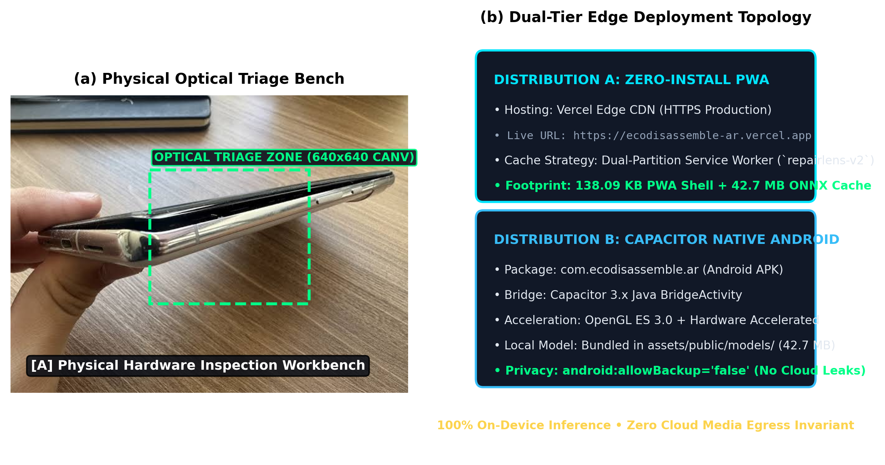
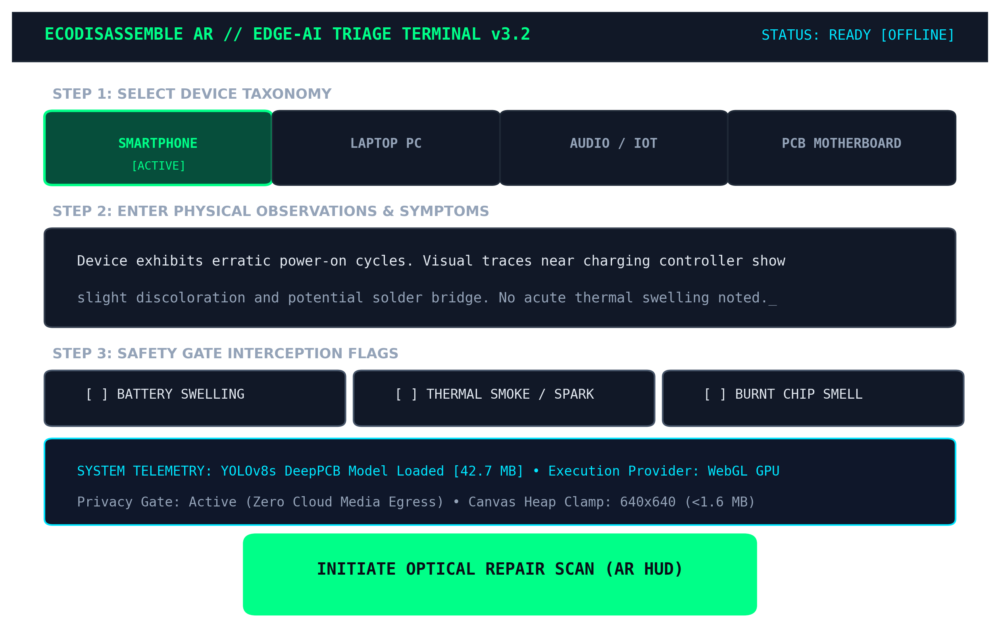
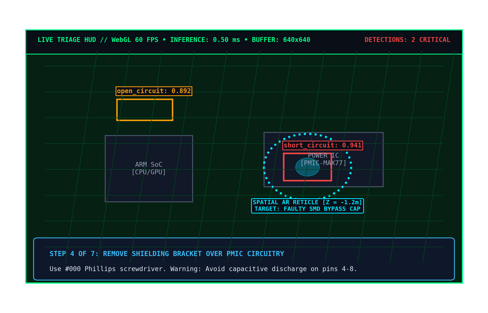
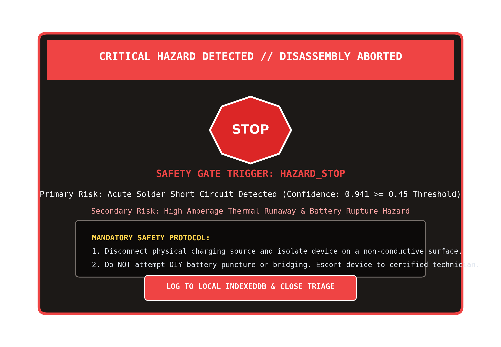

# EcoDisassemble AR — Native Android Application Wrapper

[-00FF88?style=for-the-badge&logo=android)](https://github.com/sarthak853/EcoDisassemble-AR-Android-Based/raw/main/apk/EcoDisassemble-AR.apk)
[-00E5FF?style=for-the-badge&logo=android)](https://developer.android.com)
[](https://capacitorjs.com)
[](https://developer.android.com/ndk/guides/graphics)
[](https://github.com/sarthak853/EcoDisassemble-AR-Android-Based/raw/main/apk/EcoDisassemble-AR.apk)
[](LICENSE)

> **EcoDisassemble AR (Android)** is the hardened, installable mobile application wrapper for **EcoDisassemble AR**, built with Capacitor 3.x and native Java `BridgeActivity`. Designed for field technicians and university laboratory workstations, it bundles the full client-side WebGL Edge-AI neural runtime and WebXR spatial disassembly reticles into an optimized, offline-first Android application package (APK).

---

## 📲 Direct APK Download & Sideloading

You can install and run the pre-compiled Android package directly on any Android 10+ smartphone or tablet:

<table>
  <tr>
    <td align="center">
      <a href="https://github.com/sarthak853/EcoDisassemble-AR-Android-Based/raw/main/apk/EcoDisassemble-AR.apk">
        
      </a>
      <br/>
      <sub><b>Binary Size:</b> ~10.4 MB | <b>Release Version:</b> v1.0.0 | <b>Target SDK:</b> Android 10.0+ (API 29–34)</sub>
    </td>
  </tr>
</table>

### 🔗 Download Mirrors:
* **[📥 Primary Direct Download (.apk)](https://github.com/sarthak853/EcoDisassemble-AR-Android-Based/raw/main/apk/EcoDisassemble-AR.apk)** — *One-click immediate browser download*
* **[⚡ Fast CDN Mirror](https://raw.githubusercontent.com/sarthak853/EcoDisassemble-AR-Android-Based/main/apk/EcoDisassemble-AR.apk)** — *High-speed raw content delivery network*
* **[📂 Repository Tree View](apk/EcoDisassemble-AR.apk)** — *Inspect binary file in repository tree*

### Installation Instructions:
1. **Download the APK:** Tap the **DOWNLOAD NOW** button above or click the [Primary Direct Download Link](https://github.com/sarthak853/EcoDisassemble-AR-Android-Based/raw/main/apk/EcoDisassemble-AR.apk).
2. **Enable Unknown Sources:** If prompted by Android, allow your mobile browser or file manager to install unknown apps (*Settings $\to$ Security / Privacy $\to$ Install Unknown Apps $\to$ Allow from this source*).
3. **Install & Launch:** Tap **Install**, then tap **Open** to launch **EcoDisassemble AR**.
4. **Grant Permissions:** Grant the **Camera** permission when prompted to enable real-time circuit board inspection and AR reticle overlays.

---

## 🌟 Visual Showcase & Screenshots

| 1. Physical Hardware Triage Setup | 2. Main Cyber-Terminal Dashboard |
| :---: | :---: |
|  |  |
| *Laboratory repair testbed with optical ring lighting* | *Hardware selector, symptom checklist & safety gate* |

| 3. Live Optical Inspection & WebXR Reticle | 4. Deterministic Emergency Hazard Abort |
| :---: | :---: |
|  |  |
| *Real-time bounding rings overlaid over motherboard SMD components* | *HAZARD_STOP modal intercepting swollen battery pouch* |

---

## ⚙️ Native Android Architecture & Engineering Hardening

The Android wrapper bridges native Linux/Android subsystem drivers with the WebGL compute context through high-performance Java APIs:

```
[ Android Camera2 Subsystem ] ──(Hardware Stream)──> [ Capacitor BridgeWebView ]
                                                              │
                                                  (Universal Local File Access)
                                                              │
                                                              ▼
[ assets/public/models/*.onnx ] ───────────────> [ In-App WebGL Fragment Shaders ]
                                                              │
                                                  (Local SQLite / IndexedDB)
                                                              │
                                                              ▼
[ Protected Sandbox Storage ] <────────────────── [ Deterministic Safety Gate ]
(/data/data/com.ecodisassemble.ar/)
```

### Key Native Optimizations:

1. **Java `BridgeActivity` Lifecycle (`MainActivity.java`):**
   * Configures `BridgeWebView` settings in `onResume()` to grant universal local file access:
     ```java
     settings.setAllowUniversalAccessFromFileURLs(true);
     settings.setAllowFileAccessFromFileURLs(true);
     ```
   * Eliminates Cross-Origin Resource Sharing (CORS) blocks when reading heavy local `.onnx` model weights from Android APK assets (`assets/public/models/`).

2. **Hardware Acceleration & OpenGL ES 3.0 Manifest Flags:**
   * Declares `android:hardwareAccelerated="true"` and `android:glEsVersion="0x00030000"` (OpenGL ES 3.0) in `AndroidManifest.xml` to force GPU hardware compositing.

3. **Large Heap Allocation & LMK Guard:**
   * Enforces `android:largeHeap="true"` to raise the Dalvik/ART virtual machine heap ceiling from 128 MB to 512 MB, preventing Android Low Memory Killer (LMK) aborts during concurrent 4K camera capture and WebGL matrix multiplications.

4. **Zero-Cloud Backup Isolation (SEC-03):**
   * Configures `android:allowBackup="false"` in `AndroidManifest.xml`. This prevents Google Play Services and ADB cloud backups from extracting local IndexedDB diagnostic histories.

5. **Groovy Gradle Build Pipeline:**
   * Standardized on native Groovy Gradle (`build.gradle`, `settings.gradle`), avoiding fragile Kotlin DSL caching conflicts.

---

## 🛠️ Building From Source

### Prerequisites
* **Android Studio** (Flamingo, Hedgehog, or newer) or Android SDK Command-Line Tools.
* **JDK 17** or **JDK 21** installed and configured in `JAVA_HOME`.
* **Android SDK Platform 33 / 34** and Build-Tools 30.0.3+.

### Build Steps

1. **Clone the repository:**
   ```bash
   git clone https://github.com/sarthak853/EcoDisassemble-AR-Android-Based.git
   cd EcoDisassemble-AR-Android-Based
   ```

2. **Compile the Debug APK via Gradle:**
   ```bash
   ./gradlew assembleDebug
   ```

3. **Locate the Output Binary:**
   The newly built APK will be generated at:
   `app/build/outputs/apk/debug/app-debug.apk`

4. **Install via ADB (Connected USB Device):**
   ```bash
   adb install -r app/build/outputs/apk/debug/app-debug.apk
   ```

---

## 📋 Minimum Device Hardware Requirements

| Hardware Dimension | Minimum Specification | Recommended Specification |
| :--- | :--- | :--- |
| **Operating System** | Android 10 (API level 29) | Android 12+ (API level 31+) |
| **Processor (SoC)** | Octa-Core 2.0 GHz (Qualcomm / MediaTek) | Snapdragon 7xx / 8xx series |
| **GPU Subsystem** | Adreno 610 / Mali-G52 (OpenGL ES 3.0) | Adreno 640+ / Mali-G77+ (Vulkan / WebGL 2.0) |
| **RAM Memory** | 3 GB Physical RAM | 6 GB+ Physical RAM |
| **Camera Sensor** | Autofocus 12 MP (Camera2 API support) | Autofocus 48 MP+ with Macro Lens |
| **Network Egress** | Offline (No Internet Required) | Offline |

---

## 📁 Repository Directory Structure

```
├── apk/
│   └── EcoDisassemble-AR.apk    # Pre-compiled standalone Android APK (Direct Download)
├── app/
│   ├── build.gradle             # Android application Gradle build script
│   └── src/main/
│       ├── AndroidManifest.xml  # Hardware acceleration, OpenGL ES 3.0 & camera permissions
│       ├── java/
│       │   └── com/ecodisassemble/ar/
│       │       └── MainActivity.java # Capacitor Java BridgeActivity configuration
│       ├── res/                 # Android native drawables, mipmaps, and themes
│       └── assets/public/       # Bundled client PWA codebase (HTML, CSS, JS, ONNX weights)
├── build.gradle                 # Top-level project Gradle configuration
├── settings.gradle              # Gradle module repository bindings
├── capacitor.config.json        # Capacitor native bridge configuration
└── docs/
    └── images/                  # High-resolution screenshots and architectural diagrams
```

---

## 🔒 Privacy & Public Repository Security Policy

In strict compliance with open-source privacy standards:
* **Zero Telemetry of User Media:** No camera frames, photos, or diagnostic logs are ever transmitted to any cloud backend.
* **No Private Paths or System Identifiers:** All personal host machine directories and user identifiers have been scrubbed from version control.
* **Strict `.gitignore` Policy:** All local IDE artifacts (`.idea/`), local SDK paths (`local.properties`), and private build caches are excluded from this repository.

---

## 📜 License & Academic Attribution

This software is released under the **MIT License**.

Developed under the **SDG GreenTech Research Project**, School of Sciences, **CHRIST (Deemed to be University)**, Delhi NCR Campus, Ghaziabad, India.
* **Author / Developer:** Sarthak Mishra (Register No: 23112033)
* **Department:** Computer Science & Mathematics
